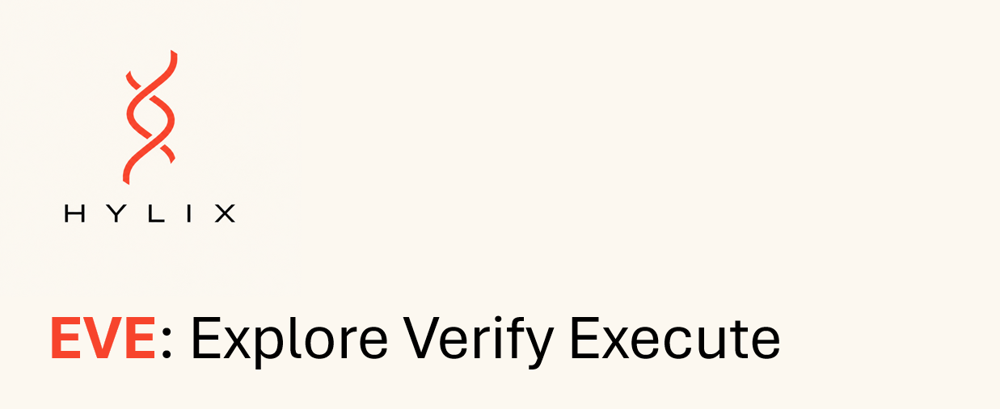
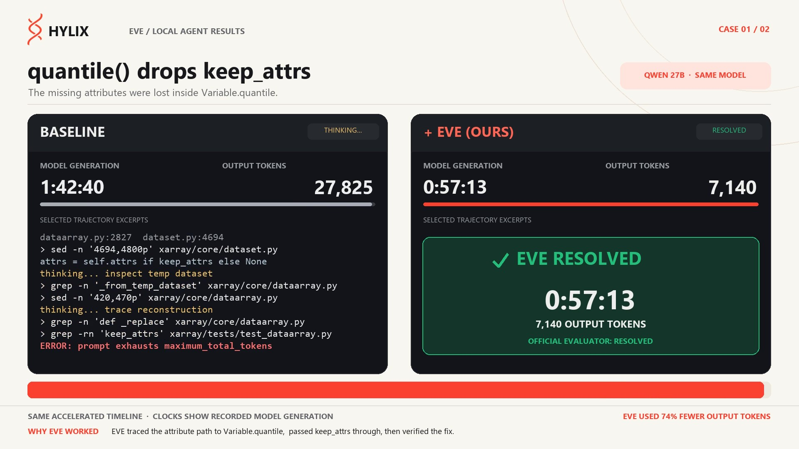

<p align="center">
  
</p>

<p align="center">
  <strong>Make open-weight coding agents finish more real work.</strong>
</p>

<p align="center">
  Inference-time guidance for Qwen3.8-27B that improves task completion and cuts wasted reasoning without retraining or replacing your model.
</p>

<p align="center">
  <strong>20% → 40% resolved on SWE-bench Verified</strong> · <strong>~40% lower time-to-completion</strong>
</p>

<p align="center">
  <a href="#try-eve">Try EVE</a> ·
  <a href="#demo">Watch the demo</a> ·
  <a href="#how-it-fits">How it fits</a> ·
  <a href="https://tally.so/r/Dq2q75">Join early users</a>
</p>

<p align="center">
  Qwen3.8-27B · NVIDIA · vLLM · OpenCode · Runs locally
</p>

---

## Demo

<p align="center">
  <a href="https://x.com/AndrewRufail/status/2110481300582772897?s=20">
    
  </a>
</p>

<p align="center">
  <strong>Same model. Same task. EVE gets more work done.</strong><br/>
  The demo shows Qwen3.8-27B on SWE-bench Verified with and without EVE.
</p>

---

## Same model. Better agent.

On our Qwen3.8-27B SWE-bench Verified evaluation:

| | Baseline | + EVE |
|---|---:|---:|
| **Resolved tasks** | 20% | **40%** |
| **Time to completion** | — | **~40% lower on average** |
| **Model** | Qwen3.8-27B | Qwen3.8-27B |
| **Retraining** | — | **None** |

We observed **no model regression in the evaluated runs**. Even on tasks the baseline already completed, EVE consistently helped the agent reach the result faster.

> EVE is optimized for completed work per unit time not for making an abstract model score look better.

---

## Why EVE exists

Open-weight models can write code, use tools, and follow instructions. The harder problem appears when you let them work autonomously on a real repository.

They investigate the wrong thing. Commit to a bad hypothesis. Spend thousands of tokens on an unproductive path. Or require an engineer to step in and tell them what to do next.

That turns AI automation into AI supervision.

**EVE improves how the model navigates the task while it is working.** It provides inference-time guidance across the reasoning process so the same model can make better decisions, recover faster, and convert more compute into completed work.

No fine-tuning. No replacement model. No new agent workflow.

---

## How it fits

EVE is designed to sit inside the stack you already chose:

<p align="center">
  <code>OpenCode → EVE → Qwen3.8-27B → vLLM → NVIDIA GPU</code>
</p>

- **Same model**: Qwen3.8-27B
- **Same agent workflow**: keep using OpenCode
- **Same infrastructure**: local or rented cloud NVIDIA GPUs
- **No retraining**: EVE acts at inference time
- **Local by default**: your code and prompts stay in your environment

If you own the GPUs, EVE helps you complete more successful work from the same hardware. If you rent them, EVE helps you complete more work with less cost spent per successful task.

---

## Try EVE

**EVE for Qwen3.8-27B is free to try. No signup is required.**

### Requirements

- NVIDIA GPU(s) with enough VRAM for the selected Qwen3.8-27B checkpoint
- Docker with NVIDIA GPU support
- Python 3.10+
- Node.js 22+
- OpenCode 1.18.x
- An existing OpenCode JSON configuration
- A Git project with at least one commit

Support for apple silicon is coming soon.

### 1. Download the current beta

**[Download EVE beta 0.2.2](https://github.com/Andrew-WR/qwen3.8-EVE/raw/refs/heads/main/eve-beta-0.2.2.zip)**

Extract the ZIP and open `START_HERE.md`.

### 2. Use these release details

```text
Docker image:
docker pull andrewrufail/eve-qwen38-27b

Release unlock code:
qFr6jB-s1UGH4cJlVw3B6b1B1Nf7S9LXldTjxWEx4JUPublisher

Publisher public-key SHA-256 fingerprint:
bb479b776acd32a8644b41626feb19b08b81aad3abb93b6092a88338e2250f00
```

Then follow the installer instructions in `START_HERE.md`. Model weights are downloaded on first setup.

> **Important:** joining the EVE early-user community is optional and is not required to activate the release.

### 3. Run OpenCode normally

Once setup is complete, EVE works behind your existing OpenCode workflow.

---

## Want us to work with you directly?

If you want direct integration help, early access to updates, or to help shape what EVE supports next, join the early-user group:

**[Join the EVE early-user community →](https://tally.so/r/Dq2q75)**

The form gives you a submission ID that can be associated with optional usage reporting and helps us work more closely with early users. It is **not required to use EVE**.

---

## Privacy

EVE is built for local and private model deployments.

EVE does **not** send:

- prompts
- model responses
- source code
- filenames
- repository contents
- email addresses

Optional usage reporting can include an installation identifier, event identifier, EVE version, and completion timing. You can disable reporting during installation with:

```bash
--telemetry-off
```

EVE continues to run with telemetry disabled.

---

## Verify the release

Current beta ZIP SHA-256:

```text
b4835d775ab5f2cb934ebf5936171871d62fedbcfc1af23d0ea5978757e9e3d2
```

Publisher public-key SHA-256 fingerprint:

```text
bb479b776acd32a8644b41626feb19b08b81aad3abb93b6092a88338e2250f00
```

The public release contains an encrypted, signed release manifest. EVE's proprietary steering vectors are not included in this repository.

---

## Using a different Qwen3.8-27B checkpoint

EVE beta 0.2.2 defaults to the pinned INT4 checkpoint. Users can select another compatible Qwen3.8-27B Hugging Face checkpoint using the installer options described in `START_HERE.md`. Other checkpoints may require more GPU memory, may use unsupported formats, and should be re-evaluated before relying on benchmark behavior.

EVE generally works on most checkpoints, but for the most predictable experience, use the default checkpoint.

---

## Roadmap

**Qwen3.8-27B remains the free EVE track.** We want it to stay easy for individual engineers to run, test, and build with.

Next, we are working toward:

- broader Qwen3.8-27B deployment and workflow support
- faster and simpler EVE integration
- support for larger open-weight models

Join the early-user community to influence what larger model will be part of EVE's offering.

---

## What is Hylix?

Hylix builds inference systems that make open-weight AI models more useful without retraining them.

EVE is our system for agentic reasoning: improving task completion while reducing the compute and time wasted on unproductive reasoning paths.

<p align="center">
  <strong>Better reasoning. Less computation.</strong>
</p>

<p align="center">
  <a href="#try-eve"><strong>Try EVE →</strong></a>
  &nbsp;&nbsp;·&nbsp;&nbsp;
  <a href="https://tally.so/r/Dq2q75">Join early users</a>
</p>
